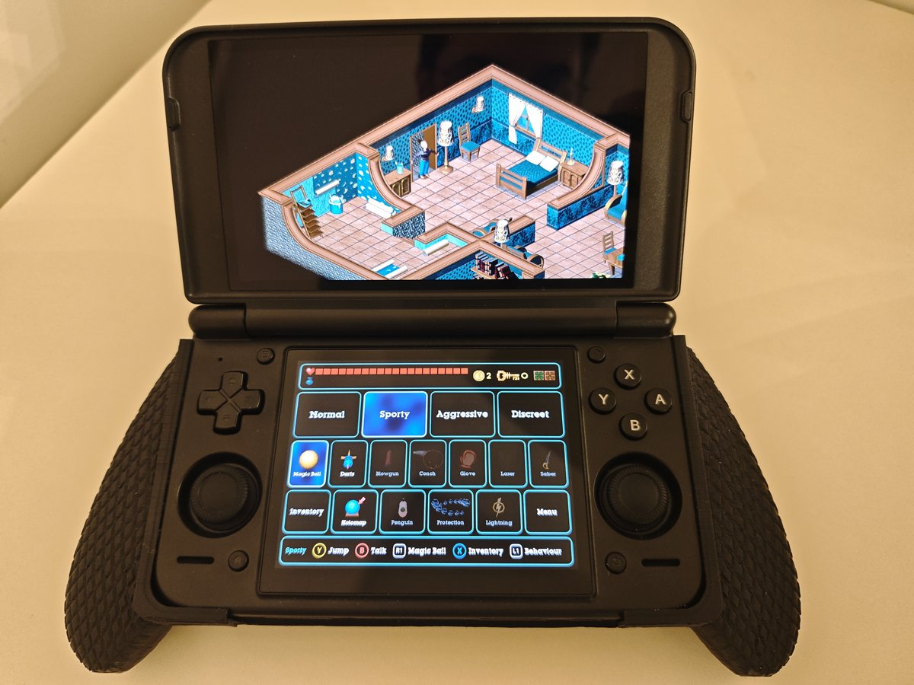

# LBA2-DS



A fork of **[LBA2 Classic Community](https://github.com/LBALab/lba2-classic-community)** for the **Retroid Pocket Duo
Lite**. Little Big Adventure 2 (Twinsen's Odyssey) plays on the top screen, and the bottom screen holds a panel for the
hero, the game's own menus and the inventory, and a touch pad for the holomap.

All credit for the engine port goes to the LBA2 Classic Community project and, before it, to Adeline Software and 2.21.

This fork keeps the community engine as it is and adds the second screen, touch and controls for the Duo Lite.

---
## Install

1. Download `lba2ds-X.Y.Z.apk` from the [latest release](https://github.com/SergeShack/lba2-classic-community/releases/latest)
   and install it. It is its own app, **LBA2-DS**, and installs next to the upstream Android build without touching its
   files.
2. Copy your game data to **`/sdcard/LBA2-DS/`**: the contents of the `Common` folder of the GOG or Steam *Twinsen's
   Little Big Adventure 2 Classic* install (`LBA2.HQR`, `RESS.HQR`, ..., with the `VIDEO` and `VOX` folders). Data
   already in `/sdcard/lba2cc/` for the upstream build is found as well. You need your own copy of LBA2; nothing of the
   game is in this repository or in the APK.
3. On first start, allow **All files access** when the game asks for it.

An update installs over the previous version and keeps your saves. Saves and settings are in
`/sdcard/LBA2-DS/user/LBA2/`.

---
## What is different from LBA2 Classic Community

### Two screens
- The game always opens on the top screen, also when started from a launcher on the bottom screen.
- The bottom screen shows a panel: life and magic, money (kashes or zlitos, for the planet you are on), keys and clover
  boxes, the four behaviours, the seven weapons and the quick items (holomap, penguin, protection, lightning). A tap
  switches behaviour or weapon or uses the item at once, by pressing the same key the game already has for it, so no
  game rule changes.
- The panel is drawn in the game's own look: its menu frames, its font, its HUD sprites and the 3D models of the items,
  all rendered by the engine from your game data when it runs.
- A bar under the panel says what the console's buttons do right now: it follows the behaviour (jump, fight, hide), the
  weapon, and the screen that is open, including dialogues (any button: next page, Start: skip).
- The game's menus, saved games, inventory, behaviour menu and slate open on the bottom screen while the top
  screen holds the last frame of play.

### Touch
- Menus: tap an entry to choose it.
- Holomap: it stays on the top screen; drag on the bottom screen to turn the globe, pinch to zoom out and back.
- Inventory, behaviour menu, slate: swipe to move, tap for the action.
- The upstream on-screen gamepad is off: the Duo Lite has its own buttons.

### Controls
- Walk and turn with the left stick or the D-pad. The triggers are free, as they sit far from the grip on the Duo Lite.
- The behaviour's action (jump, fight, hide) is on the bottom face button (B on the Duo Lite), talk and search on the
  left one (Y).
- Tapping the bottom screen does not take the controller away from the game.

These are the defaults of this build. A `lba2.cfg` that already lists its gamepad buttons keeps them; reset them in the
game's controls menu to get these.

---
## Building

The APKs on the releases page are built this way. The engine is built as in the upstream project
([docs/ANDROID.md](docs/ANDROID.md)); the second screen is a Gradle project in `android-ds/` (Kotlin, Jetpack Compose).

```bash
bash scripts/dev/build-sdl3-android.sh      # once
export ANDROID_NDK=<NDK r28 or later> SDL3_ANDROID_DIR=$PWD/out/android/sdl3-install
export ANDROID_HOME=<Android SDK> JAVA_HOME=<JDK 17 or later>
bash scripts/dev/build-android-ds.sh        # dist/lba2ds-<version>.apk
```

How the two screens work together, and how to test the panel from adb: [docs/ANDROID_DS.md](docs/ANDROID_DS.md).

---
## Credits

- **[LBA2 Classic Community](https://github.com/LBALab/lba2-classic-community)** (LBALab): the engine port this fork is
  based on. Its own README, with the full feature list and the desktop builds, is
  [here](https://github.com/LBALab/lba2-classic-community#readme).
- **[lba2-classic](https://github.com/2point21/lba2-classic)** (2.21): the original 1997 source release.
- **Little Big Adventure 2**, developed by Adeline Software International. The intellectual property is owned by 2.21.
  Buy the game on [GOG](https://www.gog.com/game/little_big_adventure_2) or
  [Steam](https://store.steampowered.com/app/398000/Little_Big_Adventure_2/).
- **[SDL3](https://www.libsdl.org/)** (zlib License) and **libsmacker** (LGPL 2.1).
- The two-screen handling (which screen the game goes on, the bottom-screen activity and its controller focus) follows
  **[OpenMW-DS Duo Lite](https://github.com/SergeShack/OpenMW-DS/tree/duo-lite)**.

The engine source is licensed under the GNU General Public License, see [LICENSE](LICENSE). It covers the code only:
the game's assets are not open source and are not redistributable.
